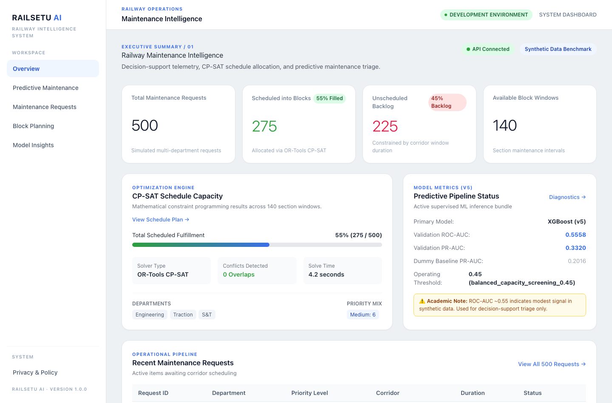
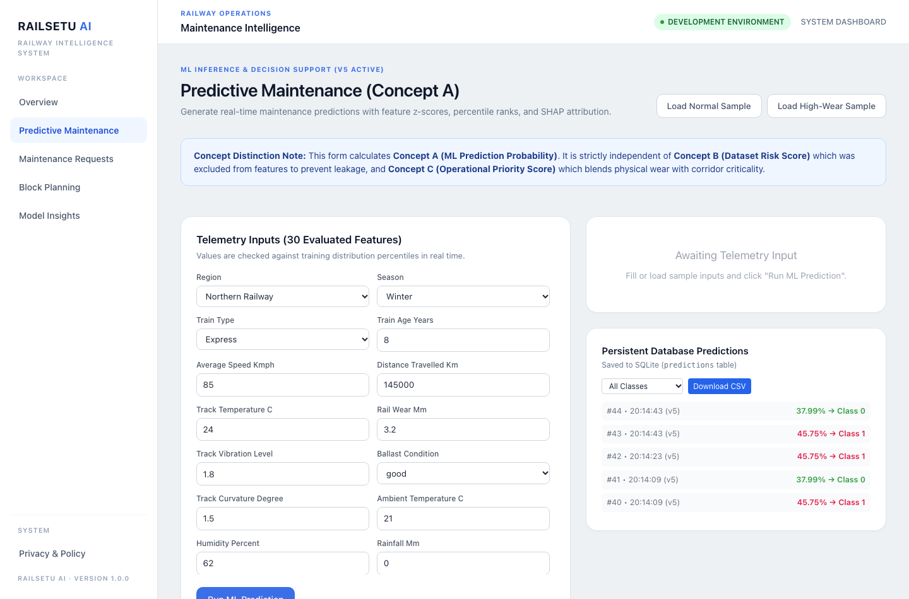
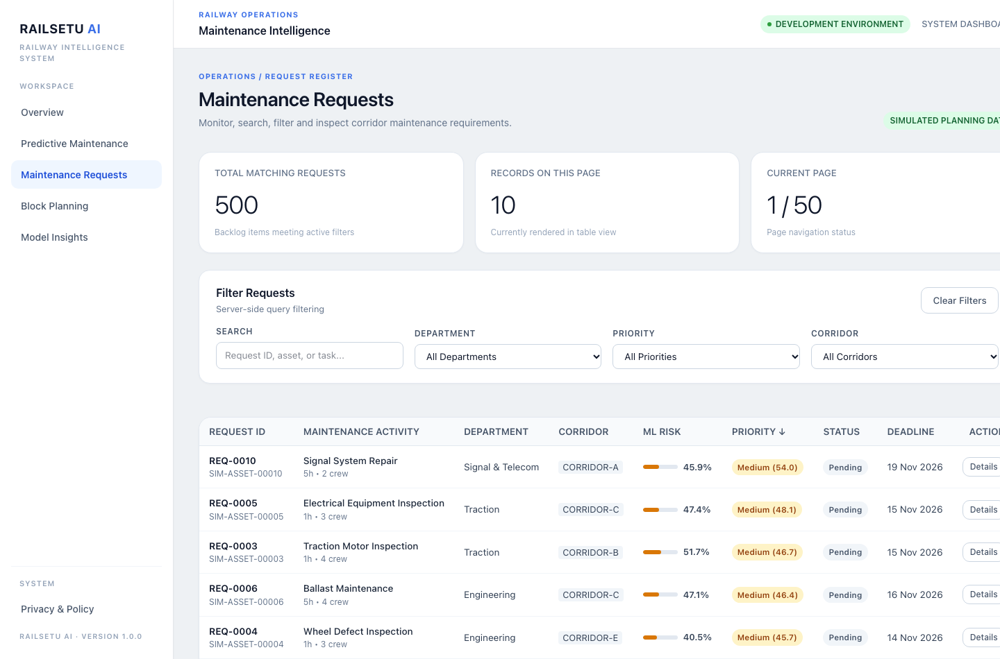
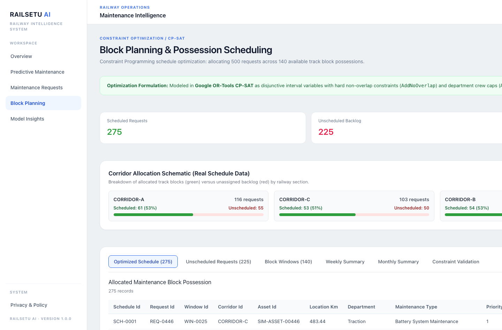
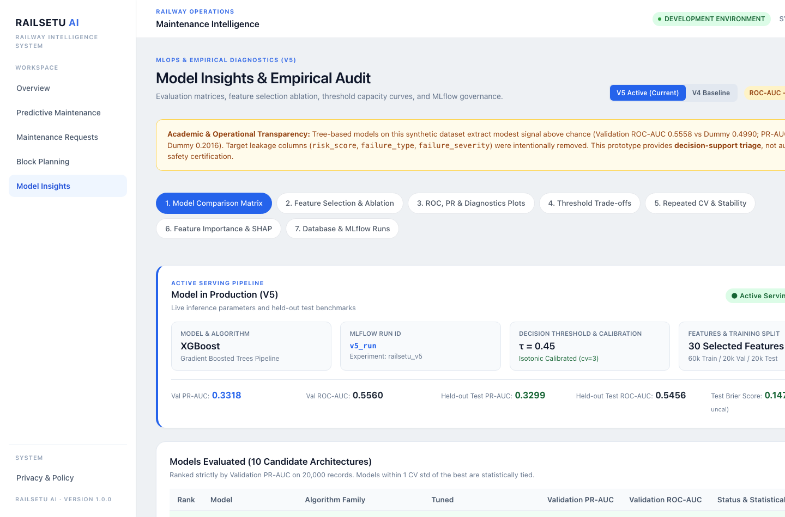
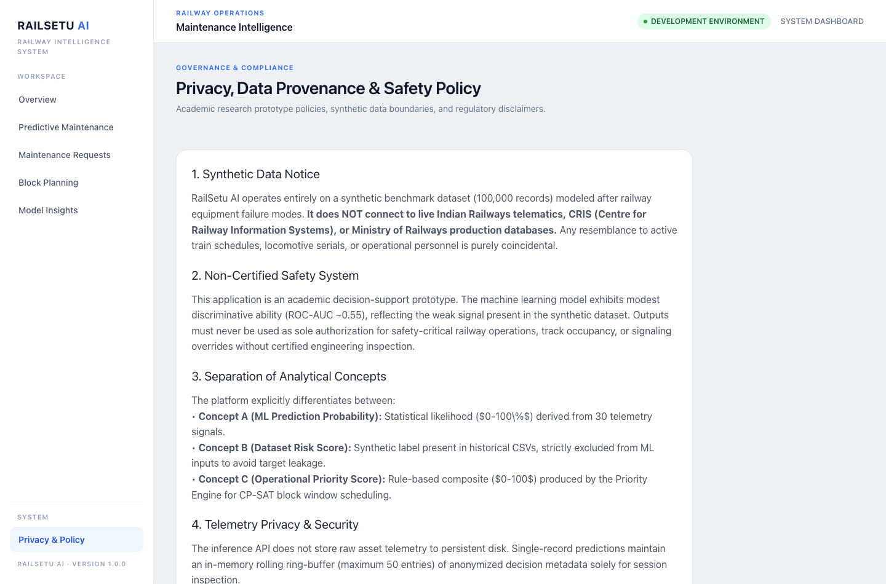

# RailSetu AI
### AI-Powered Railway Predictive Maintenance and Automatic Block Planning System

<p align="center">
**Predictive Maintenance (Concept A) | Dataset Risk Score (Concept B) | Operational Priority & CP-SAT Scheduling (Concept C)**
</p>

> **⚠️ Academic Prototype & Data Notice:** RailSetu AI is an academic research prototype. All experiments, predictions, and schedules run on a 100,000-record synthetic/simulated benchmark dataset from Kaggle. **It is NOT connected to live Indian Railways, CRIS, or Ministry of Railways telematics.** The machine learning model exhibits modest discriminative power (ROC-AUC ~0.55 on leak-free features), reflecting the weak signal present in the synthetic data. It is intended for decision support only and is NOT a certified railway safety system.

---

## Visual Tour (Dashboard & System Interfaces)

| Interface | Preview (1440px Desktop) | Description |
|---|---|---|
| **Operations Dashboard** |  | High-level KPIs (500 requests, 275 scheduled, 225 unscheduled), CP-SAT capacity bar, and active V5 model status. |
| **Predictive Maintenance** |  | Validated 30-feature telemetry form, failure probability %, decision banner, top-5 local SHAP attributions, real-time z-score anomaly detection, and persistent SQLite history. |
| **Maintenance Register** |  | Rebuilt enterprise filter card (department, priority, corridor dropdowns), sortable table, risk mini-bars, pagination, and slide-over details drawer. |
| **Block Planning** |  | OR-Tools CP-SAT corridor network schematic, interval possessions, and unscheduled request backlog breakdown. |
| **Model Insights (v5)** |  | "Model in Production" banner, 10-model ranking table with statistical-tie detection ($\le 1\sigma$), selection rule breakdown (English + Hinglish), empirical verdict, ROC/PR curves, and MLflow run tracing. |
| **Governance & Policy** |  | Explicit academic disclaimers, synthetic data provenance, and telemetry privacy commitments. |

---

## 1. Project Overview

RailSetu AI is an AI-powered railway maintenance decision-support prototype designed to combine predictive maintenance, equipment condition assessment, maintenance prioritization, and railway maintenance block planning into one unified system.

Railway infrastructure requires regular inspection and maintenance to maintain operational reliability. Maintenance activities often require track blocks or restricted operating windows, making maintenance planning a coordination challenge.

RailSetu AI aims to address this challenge through a data-driven workflow that:

1. Analyzes railway maintenance and equipment-related data.
2. Predicts the likelihood of maintenance requirements using machine learning.
3. Explains model predictions through feature importance and SHAP.
4. Generates and prioritizes maintenance requests.
5. Simulates available maintenance block windows.
6. Assigns maintenance requests to suitable block windows.
7. Generates weekly and monthly maintenance plans.
8. Exposes results through REST APIs for dashboard integration.

The project currently operates as a **prototype decision-support system** using a simulated planning environment and a historical/synthetic dataset. It is not connected to live Indian Railways operational systems.

## 2. Problem Statement

Railway maintenance involves multiple engineering departments, infrastructure components, inspection activities, and operational constraints.

Some important challenges include:

- Identifying assets that may require maintenance.
- Prioritizing maintenance requests according to risk and equipment condition.
- Coordinating maintenance work across departments.
- Finding suitable time windows for maintenance activities.
- Reducing scheduling conflicts.
- Tracking scheduled and unscheduled maintenance work.
- Preparing weekly and monthly maintenance plans.

Traditional manual workflows can make it difficult to combine predictive insights with maintenance scheduling decisions.

**Proposed solution:** RailSetu AI combines machine learning, risk scoring, priority-based scheduling, and optimization techniques to create a unified maintenance planning workflow.

## 3. Project Objectives

The major objectives are:

- Develop a machine learning pipeline for maintenance requirement prediction.
- Compare multiple classification algorithms.
- Identify important features affecting model predictions.
- Develop an equipment condition and operational priority scoring mechanism.
- Generate maintenance requests for different railway departments.
- Simulate railway corridors and available maintenance windows.
- Optimize the allocation of maintenance requests to available windows.
- Generate weekly and monthly maintenance plans.
- Build a FastAPI backend to expose project functionality.
- Develop a foundation for a future interactive monitoring dashboard.

## 4. Technology Stack

| Layer | Technologies |
|---|---|
| **Backend & API** | Python 3.11+, FastAPI, Uvicorn, Pydantic v2, SQLAlchemy 2 |
| **Database** | SQLite (`data/railsetu.db`), Alembic / Python seeder |
| **Machine Learning** | Scikit-learn 1.6, XGBoost 2.1, LightGBM 4.7, CatBoost 1.2, Optuna 5.0, Joblib, MLflow 2.19 |
| **Model Explainability** | SHAP (TreeExplainer) |
| **Block Optimization** | Google OR-Tools CP-SAT (Constraint Programming) |
| **Frontend Dashboard** | React 19, TypeScript, Vite, Tailwind CSS v4, Lucide Icons, Axios |
| **Automated Testing** | Pytest 9.2, FastAPI TestClient (67 tests passing) |
| **Visualization & Reporting** | Matplotlib, Seaborn, KaTeX |

---

## 5. Quickstart & Installation

### Backend Setup
```bash
# Clone and enter directory
cd RailSetu-AI

# Activate Python virtual environment
source .venv/bin/activate

# Install dependencies if not already present
pip install -r requirements.txt

# Seed relational database (creates data/railsetu.db)
python -m scripts.seed_db

# Run all 67 backend tests
PYTHONPATH=. pytest tests/ -v

# Start FastAPI server (runs on port 8000)
uvicorn backend.app.main:app --host 127.0.0.1 --port 8000 --reload
```

### Frontend Setup
```bash
cd frontend

# Install Node dependencies
npm install

# Build production bundle (tsc -b && vite build)
npm run build

# Start local development server (runs on port 5173)
npm run dev
```

Open [http://localhost:5173](http://localhost:5173) in your browser.

---

## 6. Dataset and Data Preparation

### Dataset

The project uses the Kaggle dataset:

**Indian Railway Failure Detection and Maintenance 100K**

The dataset contains approximately 100,300 records before cleaning.

It is used to develop and evaluate the maintenance prediction pipeline.

### Data Cleaning

The initial data preparation workflow included:

1. Loading the original dataset.
2. Inspecting dataset dimensions and column information.
3. Checking missing values.
4. Identifying duplicate records.
5. Removing approximately 300 duplicate records.
6. Handling missing numerical values using median imputation.
7. Preparing the cleaned dataset for exploratory analysis and model development.

Final cleaned dataset size: **approximately 100,000 records.**

### Target Variable

`maintenance_required`

This is the binary classification target.

| Value | Meaning | Records |
|---|---|---:|
| 0 | Maintenance not required | 79,804 |
| 1 | Maintenance required | 20,196 |

The positive class represents approximately 20.2% of the cleaned dataset.

### Train-Test Split

The dataset was divided into:

- Training set: 80%
- Testing set: 20%

The model preparation workflow produced 30 model input features:

- 25 numerical features
- 5 categorical features

### Feature Leakage Prevention

During model preparation, the following columns were excluded:

- `train_id` – identifier rather than a predictive feature.
- `failure_type` – directly associated with the target.
- `failure_severity` – directly associated with the target.
- `risk_score` – excluded from the training inputs.

This was done to reduce target leakage and prevent the model from learning information that would not be appropriate as an independent prediction input.

## 6. Exploratory Data Analysis

Exploratory Data Analysis (EDA) was performed to understand the dataset before model training.

The analysis included:

- Dataset structure and data types.
- Missing-value distribution.
- Duplicate record inspection.
- Target class distribution.
- Numerical feature distributions.
- Categorical feature distributions.
- Feature relationships and correlations.
- Comparison of maintenance and non-maintenance records.

The purpose of EDA was to understand the characteristics of the dataset, detect data-quality issues, and identify patterns that could be useful during model development.

## 7. Machine Learning Pipeline

RailSetu AI uses a supervised binary classification approach.

The target is to estimate whether maintenance is required based on the available equipment, operational, environmental, and infrastructure-related input features.

### Models Implemented

Three primary machine learning algorithms were evaluated.

**1. Logistic Regression**

Used as a baseline classification algorithm to establish an initial performance reference.

**2. Random Forest Classifier**

An ensemble learning algorithm that combines multiple decision trees to model nonlinear relationships.

**3. XGBoost Classifier**

A gradient boosting algorithm that builds an ensemble of decision trees sequentially.

A dummy classifier was also included as a baseline reference.

### Model Evaluation

The following evaluation metrics were used:

- Accuracy
- Precision
- Recall
- F1-score
- F2-score
- ROC-AUC
- Average Precision (AP)

Average Precision was particularly useful because the target classes are imbalanced.

### Actual Model Results

| Model | Accuracy | Precision | Recall | F1-score | ROC-AUC | Average Precision |
|---|---:|---:|---:|---:|---:|---:|
| Logistic Regression | 0.6057 | 0.2294 | 0.4038 | 0.2926 | 0.5383 | 0.2529 |
| Random Forest | 0.8134 | 0.7308 | 0.1203 | 0.2066 | 0.5506 | 0.3349 |
| XGBoost | 0.7148 | 0.2779 | 0.2580 | 0.2676 | 0.5508 | 0.3339 |
| Dummy Classifier | 0.7981 | — | 0.0000 | — | — | 0.2020 |

*Values shown are the recorded test-set results, rounded to four decimal places.*

### Model Selection

XGBoost was selected as the best model according to the validation Average Precision comparison.

Recorded validation Average Precision: approximately **0.3322**.

The selected model is stored as a serialized model artifact and loaded by the backend prediction service.

**Important:** The current predictive performance is limited. ROC-AUC values are only slightly above random ranking performance. The results should be treated as experimental rather than as a reliable operational prediction system.

## 8. Model Explainability – SHAP

RailSetu AI includes a model explainability module using SHAP (SHapley Additive exPlanations).

SHAP helps analyze how individual features contribute to model predictions.

The explainability workflow generates:

- Feature importance analysis.
- SHAP summary plot.
- Individual prediction explanation.
- Waterfall visualization.
- Feature importance CSV.

Important generated files include:

```text
backend/artifacts/explainability/
├── shap_feature_importance.csv
├── individual_prediction_explanation.csv
├── individual_waterfall.png
├── shap_feature_importance.png
└── shap_summary_plot.png
```

These outputs provide insight into the behavior of the selected machine learning model.

SHAP explanations describe model behavior; they do not establish real-world causality.

## 9. Maintenance Request Simulation

After the machine learning pipeline, the system generates a simulated maintenance request dataset.

The purpose is to create maintenance jobs that can be processed by the priority engine and block optimizer.

The current simulation generates **500 maintenance requests**.

### Department Distribution

| Department | Requests |
|---|---:|
| Engineering | 174 |
| Traction | 165 |
| Signal & Telecom | 161 |
| **Total** | **500** |

The initial simulated priority distribution was:

| Priority | Requests |
|---|---:|
| Medium | 344 |
| Low | 149 |
| High | 7 |

Generated file:

```text
backend/artifacts/simulation/simulated_maintenance_requests.csv
```

These are simulated planning requests, not verified live railway maintenance jobs.

## 10. Maintenance Priority Engine

The priority engine ranks maintenance requests to help determine which jobs should be considered first.

It processes the generated maintenance request dataset and produces ranked maintenance records.

The output includes:

- Ranked maintenance requests.
- Department-wise priority summary.
- Priority information for downstream scheduling.

Generated files:

```text
backend/artifacts/priority/
├── ranked_maintenance_requests.csv
└── department_priority_summary.csv
```

The objective is to make maintenance planning more structured by considering the priority assigned to each request.

## 11. Equipment Condition and Operational Risk Scoring

RailSetu AI includes a separate risk-scoring service.

This service combines the machine learning model output with a condition-based assessment.

### Scoring Weights

| Component | Weight |
|---|---:|
| Model risk probability | 40% |
| Equipment condition score | 60% |

The resulting operational priority score is categorized as:

| Score | Priority |
|---|---|
| 70 or above | High |
| 40 to below 70 | Medium |
| Below 40 | Low |

The service provides:

- Model risk probability.
- Equipment condition score.
- Combined operational priority score.
- Priority classification.
- An explanatory disclaimer.

**Important distinction:** This combined score is a prototype prioritization mechanism. It is not an officially calibrated railway safety rating or a verified failure probability.

## 12. Railway Block Window Simulation

Maintenance activities may require designated maintenance windows.

The project simulates available block windows across multiple railway corridors.

### Current Simulation Configuration

- 5 simulated corridors.
- 14 days of planning horizon.
- 2 maintenance windows per day per corridor.
- 140 total simulated block windows.

Generated file:

```text
backend/artifacts/simulation/simulated_block_windows.csv
```

These windows provide the availability input for the maintenance block optimizer.

They do not represent actual Indian Railways timetable availability or officially approved traffic blocks.

## 13. Automatic Block Planning and Optimization

The block optimizer is responsible for assigning maintenance requests to suitable simulated maintenance windows.

The workflow considers:

- Maintenance request details.
- Priority ranking.
- Department information.
- Corridor information.
- Available block windows.
- Maintenance duration and capacity constraints.
- Scheduling feasibility.

### Optimization Output

The latest recorded optimization run produced:

| Metric | Result |
|---|---:|
| Total maintenance requests | 500 |
| Scheduled requests | 275 |
| Unscheduled requests | 225 |
| Scheduled work hours | 641 |

### Generated Files

```text
backend/artifacts/optimization/
├── optimized_maintenance_schedule.csv
├── unscheduled_maintenance_requests.csv
├── optimization_summary.csv
└── schedule_validation_report.csv
```

### Schedule Validation

The system generates a validation report to check scheduling constraints.

The latest recorded validation run passed all 8 implemented checks.

This validates the implemented prototype constraints only. It does not establish compliance with official railway engineering, traffic, or safety regulations.

## 14. Weekly and Monthly Maintenance Planning

The weekly and monthly planner converts the optimized maintenance schedule into planning summaries.

It provides a higher-level view of maintenance activities.

### Current Planning Results

- Scheduled jobs: 275.
- Unscheduled jobs: 225.
- Scheduled work hours: 641.
- Weekly planning periods: 2.
- Monthly planning periods: 1.

### Department-wise Monthly Jobs

| Department | Scheduled Jobs |
|---|---:|
| Engineering | 98 |
| Signal & Telecom | 93 |
| Traction | 84 |
| **Total** | **275** |

### Generated Files

```text
backend/artifacts/planning/
├── weekly_maintenance_plan.csv
├── monthly_maintenance_plan.csv
├── weekly_department_summary.csv
├── monthly_department_summary.csv
├── weekly_corridor_summary.csv
├── monthly_corridor_summary.csv
├── planning_kpis.json
└── unscheduled_requests_for_planning.csv
```

These outputs can be consumed by a future dashboard to display maintenance workload and planning performance.

## 15. Backend Architecture

The project includes a modular FastAPI backend.

Its main responsibilities are:

- Exposing dashboard data.
- Loading generated artifacts.
- Filtering and paginating records.
- Running machine learning predictions.
- Calculating operational risk scores.
- Providing planning and optimization results.
- Logging incoming requests.
- Handling application-level errors.

### Current Backend Structure

```text
backend/
│
├── __init__.py
│
├── app/
│   ├── __init__.py
│   ├── main.py
│   │
│   ├── api/
│   │   ├── __init__.py
│   │   └── dashboard.py
│   │
│   ├── core/
│   │   ├── __init__.py
│   │   ├── config.py
│   │   └── logging_config.py
│   │
│   ├── database/
│   │   └── __init__.py
│   │
│   ├── models/
│   │   └── __init__.py
│   │
│   ├── schemas/
│   │   ├── __init__.py
│   │   └── prediction.py
│   │
│   └── services/
│       ├── __init__.py
│       ├── artifact_service.py
│       ├── filter_service.py
│       ├── model_service.py
│       └── risk_service.py
│
├── ml/
├── optimization/
├── planning/
├── simulation/
│
├── artifacts/
└── requirements.txt
```

### Main Backend Components

**1. `main.py`**

Creates the FastAPI application, registers routes, configures logging, and defines middleware and global exception handling.

**2. `dashboard.py`**

Contains API endpoints for dashboard summaries, maintenance requests, optimized schedules, planning reports, ML information, explainability outputs, validation reports, and simulation windows.

**3. `config.py`**

Uses Pydantic Settings to manage application configuration through environment variables and `.env`.

**4. `logging_config.py`**

Configures application logging with timestamps, log levels, logger names, and messages.

**5. `artifact_service.py`**

Loads CSV and JSON artifacts generated by the ML, simulation, optimization, and planning modules.

**6. `filter_service.py`**

Provides reusable filtering and pagination functionality for API responses.

**7. `model_service.py`**

Loads the selected XGBoost model and performs maintenance predictions using incoming feature records.

**8. `risk_service.py`**

Combines model predictions and equipment condition assessment to calculate operational priority scores.

**9. `prediction.py`**

Defines Pydantic request schemas and validates prediction and risk-scoring input records.

## 16. REST API Documentation

The backend exposes **19 API paths**, including 15 GET endpoints, 2 POST endpoints, the root endpoint, and the health endpoint.

### General Endpoints

| Method | Endpoint | Purpose |
|---|---|---|
| GET | `/` | Application information |
| GET | `/health` | Backend health status |

### Dashboard and Maintenance APIs

| Method | Endpoint | Purpose |
|---|---|---|
| GET | `/api/dashboard/summary` | Overall dashboard KPIs |
| GET | `/api/maintenance/requests` | Maintenance request records |
| GET | `/api/maintenance/priority` | Ranked maintenance requests |

### Scheduling and Planning APIs

| Method | Endpoint | Purpose |
|---|---|---|
| GET | `/api/schedule/optimized` | Optimized maintenance schedule |
| GET | `/api/schedule/unscheduled` | Unscheduled maintenance requests |
| GET | `/api/planning/weekly` | Weekly maintenance plan |
| GET | `/api/planning/monthly` | Monthly maintenance plan |
| GET | `/api/planning/departments` | Department planning summaries |
| GET | `/api/planning/corridors` | Corridor planning summaries |
| GET | `/api/simulation/block-windows` | Simulated maintenance windows |

### Machine Learning and Optimization APIs

| Method | Endpoint | Purpose |
|---|---|---|
| GET | `/api/ml/model-comparison` | Model evaluation comparison |
| GET | `/api/ml/best-model` | Selected model information |
| GET | `/api/ml/feature-importance` | Feature importance results |
| GET | `/api/ml/prediction-explanations` | Individual prediction explanations |
| GET | `/api/optimization/validation` | Schedule validation results |

### Prediction and Risk APIs

| Method | Endpoint | Purpose |
|---|---|---|
| POST | `/api/ml/predict` | Predict maintenance requirement |
| POST | `/api/risk/score` | Calculate operational priority score |

### Example Prediction Request

Both prediction and risk-scoring APIs accept a request body containing a `records` array.

```json
{
  "records": [
    {
      "region": "Southern Railway",
      "season": "Summer",
      "train_type": "Passenger",
      "train_age_years": 12,
      "average_speed_kmph": 65,
      "distance_travelled_km": 450,
      "track_temperature_c": 42,
      "rail_wear_mm": 2.5,
      "track_vibration_level": 3.2,
      "ballast_condition": "Good",
      "track_curvature_degree": 1.5,
      "ambient_temperature_c": 35,
      "humidity_percent": 60,
      "rainfall_mm": 5,
      "wind_speed_kmph": 12,
      "wheel_wear_percent": 20,
      "axle_temperature_c": 45,
      "brake_pressure_psi": 90,
      "brake_pad_wear_percent": 25,
      "bearing_temperature_c": 50,
      "battery_voltage": 24,
      "traction_motor_temp_c": 55,
      "signal_system_status": "Normal",
      "power_consumption_kw": 120,
      "load_factor_percent": 70,
      "daily_trips": 8,
      "delay_minutes": 10,
      "last_maintenance_days": 60,
      "inspection_score": 85,
      "sensor_health_index": 90
    }
  ]
}
```

*This is an illustrative schema example, not a verified real-world operational record. Actual category values and feature distributions should match the training data.*

### API Response

The prediction endpoint returns the selected model information and prediction results, including:

- Maintenance probability percentage.
- Predicted maintenance class.
- Model information.
- Applicable threshold.
- Prototype disclaimer.

The risk-scoring endpoint additionally returns:

- Equipment condition score.
- Operational priority score.
- Priority level.

### Interactive API Documentation

Once the backend is running, access:

- Swagger UI: `http://127.0.0.1:8000/docs`
- ReDoc: `http://127.0.0.1:8000/redoc`

## 17. Installation and Setup

### Prerequisites

- Python 3.10 or higher, subject to dependency compatibility.
- Git.
- VS Code or another Python IDE.
- macOS, Linux, or Windows.

### Step 1: Clone the Repository

```bash
git clone <YOUR_GITHUB_REPOSITORY_URL>
cd RailSetu-AI
```

### Step 2: Create a Virtual Environment

```bash
python3 -m venv .venv
```

Activate it:

```bash
source .venv/bin/activate
```

### Step 3: Install Dependencies

```bash
pip install --upgrade pip
pip install -r backend/requirements.txt
```

### Step 4: Configure Environment Variables

Create a local `.env` file using `.env.example` as a reference.

```env
APP_NAME="RailSetu AI"
APP_VERSION="1.0.0"
APP_ENV="development"
DEBUG=false
```

Do not commit `.env` or any secrets to GitHub.

### Step 5: Start the Backend

Run from the project root:

```bash
uvicorn backend.app.main:app --reload
```

The API will be available at:

```text
http://127.0.0.1:8000
```

Open the Swagger interface:

```text
http://127.0.0.1:8000/docs
```

**Note:** The backend depends on previously generated model and planning artifacts. Reproduce the data preparation, training, simulation, optimization, and planning outputs before starting the application in a fresh environment. The original datasets and generated artifacts are excluded from Git by the current `.gitignore`.

## 18. Testing

RailSetu AI includes automated backend tests using Pytest and FastAPI TestClient.

The current test suite covers:

- API endpoint functionality.
- Artifact loading.
- Filtering and pagination.
- Maintenance prediction.
- Missing prediction features.
- Empty prediction records.
- Risk scoring.
- Missing risk-scoring features.

### Run Tests

```bash
python -m pytest tests/ -q
```

### Coverage Report

```bash
python -m pytest tests/ --cov=backend.app --cov-report=term-missing
```

### Current Test Status

**33 automated tests passed** in the latest confirmed test run.

Earlier backend application coverage measurement reached 100% for the measured `backend.app` modules. This should not be interpreted as 100% coverage of the entire ML, simulation, optimization, and planning project.

## 19. Current Project Status

The following components have been implemented:

| Component | Status |
|---|---|
| Dataset cleaning and preprocessing | Completed |
| Exploratory Data Analysis | Completed |
| Feature preparation | Completed |
| Train-test split | Completed |
| Logistic Regression | Completed |
| Random Forest | Completed |
| XGBoost | Completed |
| Model comparison | Completed |
| SHAP explainability | Completed |
| Maintenance request simulation | Completed |
| Maintenance priority engine | Completed |
| Equipment risk scoring service | Completed |
| Block window simulation | Completed |
| Maintenance block optimization | Completed |
| Schedule validation | Completed |
| Weekly and monthly planning | Completed |
| FastAPI backend | Implemented |
| Prediction API | Implemented |
| Risk-scoring API | Implemented |
| Automated backend tests | 33 passed |
| Environment configuration | Implemented |
| README documentation | In progress |

## 20. Important Limitations

RailSetu AI is currently a research and development prototype.

The following limitations must be considered:

1. The Kaggle dataset is synthetic/simulated and is not verified operational Indian Railways data.
2. The machine learning model currently demonstrates limited predictive performance.
3. The prediction probability should not be treated as a calibrated real-world failure probability.
4. Maintenance requests and block windows are simulated.
5. The planning environment does not use live railway timetables.
6. The system is not integrated with railway operational systems such as TMS, SMMS, TDMS, or COA.
7. Scheduling validation covers only the constraints implemented in this prototype.
8. The operational priority score is not an officially approved railway safety rating.
9. The backend currently uses generated CSV and JSON artifacts rather than a fully integrated production database.
10. The current implementation is a modular application, not a deployed microservices platform.

All predictions and schedules are intended for demonstration and research purposes. They must not be used as the sole basis for real railway maintenance or safety decisions.

## 21. Future Scope

Potential future enhancements include:

- Improve model performance using verified, representative railway maintenance data.
- Perform stronger feature engineering and model calibration.
- Integrate real-time IoT sensor streams.
- Develop asset-level predictive maintenance monitoring.
- Introduce a production relational database.
- Add user authentication and role-based access control.
- Develop an interactive React dashboard.
- Visualize corridor-wise maintenance activities.
- Add real-time maintenance status updates.
- Introduce advanced constraint programming for scheduling.
- Incorporate approved operational constraints and authorized timetable data.
- Develop notification and alert mechanisms.
- Deploy the backend using Docker and cloud infrastructure.
- Introduce monitoring, model versioning, and automated retraining workflows.
- Explore a distributed microservices architecture if future scale requires it.

## 22. Conclusion

RailSetu AI brings together machine learning, explainable AI, equipment condition assessment, maintenance prioritization, and automated maintenance block planning in a unified railway maintenance decision-support prototype.

The project demonstrates an end-to-end workflow—from dataset preprocessing and model training to simulated maintenance scheduling, planning summaries, and API-based backend integration.

Its current foundation can be extended with better-quality operational data, improved predictive models, verified railway constraints, persistent storage, and an interactive dashboard.

---

**Project:** RailSetu AI
**Category:** AI / Machine Learning / Railway Predictive Maintenance / Optimization
**Backend:** FastAPI
**Primary ML Model:** XGBoost
**Current Implementation:** Research and Development Prototype
**Purpose:** Railway Maintenance Decision Support
