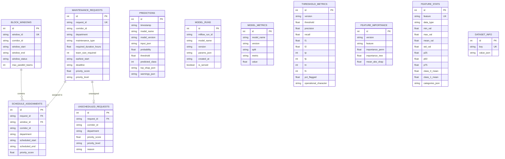

# RailSetu AI - Database Schema Documentation

This document describes the relational database layer for RailSetu AI using SQLAlchemy 2.x and SQLite (`data/railsetu.db`).

## Overview

The database stores operational simulation data, optimizer schedules, model experiment telemetry, performance metrics across splits, threshold analysis, feature importance rankings, and real-time prediction history.

## Mermaid Entity-Relationship Diagram

## Seeding & Idempotency

The database is seeded via `python -m scripts.seed_db`. The seeder:
1. Re-initializes all tables if missing (`init_db()`).
2. Clears existing data to ensure full idempotency.
3. Ingests simulated requests (500) and block windows (140).
4. Populates CP-SAT optimization results (275 scheduled, 225 unscheduled).
5. Populates model runs, all train/val/test evaluation metrics for v4 and v5 models, threshold evaluations, and feature rankings.
6. Computes distribution percentiles, min/max/std, and class conditional means for all 30 features from training data for runtime z-score and anomaly detection.
