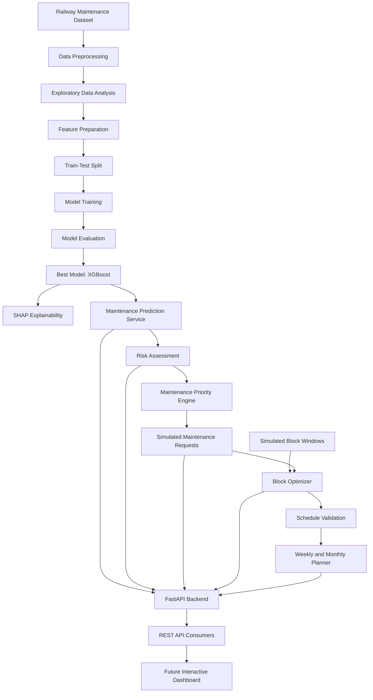
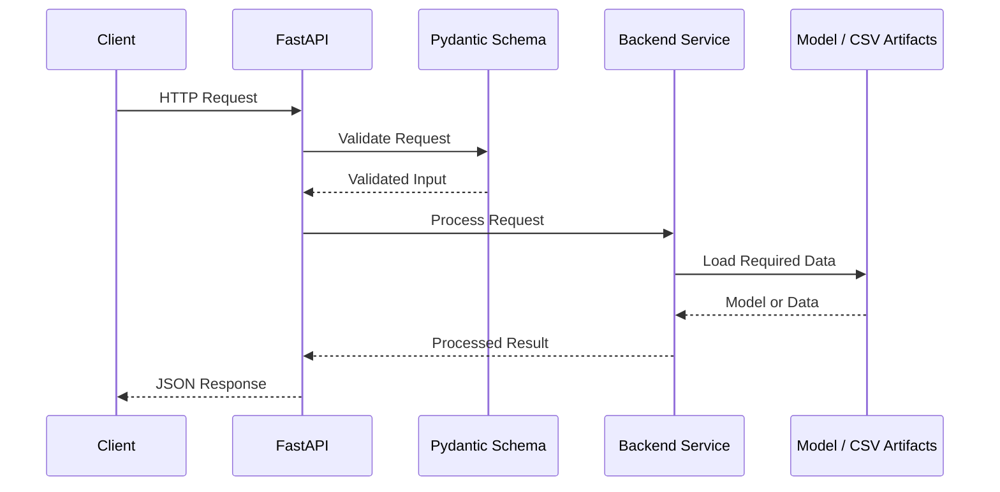

# RailSetu AI — System Architecture

## 1. Introduction

RailSetu AI is an AI-powered railway predictive maintenance and automatic block planning prototype.

The system combines machine learning, explainable AI, equipment condition assessment, maintenance prioritization, simulated block-window allocation, and maintenance planning.

Its architecture follows a modular application design in which different components perform specific responsibilities and exchange data through generated artifacts and backend services.

The current implementation uses a Python-based processing pipeline and a FastAPI backend.

## 2. High-Level Architecture

The system consists of six major layers:

1. Data Layer
2. Machine Learning Layer
3. Risk Assessment and Prioritization Layer
4. Simulation and Optimization Layer
5. Planning Layer
6. API and Application Layer

### Architecture Diagram



*The diagram represents the logical workflow. The future dashboard is not yet implemented.*

## 3. Data Layer

The data layer provides the input required for machine learning and planning operations.

### Dataset

The project uses the Kaggle Indian Railway Failure Detection and Maintenance 100K dataset.

The original dataset contained approximately 100,300 records.

After preprocessing:
- Approximately 300 duplicate records were removed.
- Missing numerical values were handled using median imputation.
- The resulting cleaned dataset contained approximately 100,000 records.

### Target Variable

`maintenance_required`

This is the binary classification target:

- 0: Maintenance not required.
- 1: Maintenance required.

### Feature Preparation

The model preparation process generated 30 features:

- 25 numerical features.
- 5 categorical features.

The following columns were excluded:

- `train_id`
- `failure_type`
- `failure_severity`
- `risk_score`

The training data was divided into an 80% training set and a 20% testing set.

## 4. Machine Learning Layer

The machine learning layer predicts whether maintenance is required based on the available input features.

### Implemented Models

Three primary classification algorithms were evaluated:

1. Logistic Regression
2. Random Forest Classifier
3. XGBoost Classifier

A Dummy Classifier was also used as a baseline.

### Model Evaluation

The models were evaluated using:

- Accuracy
- Precision
- Recall
- F1-score
- F2-score
- ROC-AUC
- Average Precision

XGBoost was selected based on validation Average Precision.

Recorded validation Average Precision: approximately 0.3322.

The selected model is saved as a serialized artifact and loaded by the prediction service.

### Explainability

The SHAP explainability module produces:

- Global feature importance.
- SHAP summary visualization.
- Individual prediction explanation.
- Waterfall visualization.

These outputs help interpret how the model uses input features.

## 5. Risk Assessment Layer

The risk assessment service combines model predictions with an equipment condition assessment.

### Scoring Formula

The implemented scoring weights are:

- Model risk probability: 40%.
- Equipment condition score: 60%.

Conceptually:

```text
Operational Priority Score =
    (Model Risk Probability × 0.40)
    +
    (Equipment Condition Score × 0.60)
```

The score is categorized as:

| Score | Priority |
|---|---|
| 70 or above | High |
| 40 to below 70 | Medium |
| Below 40 | Low |

This is a prototype operational prioritization mechanism, not an official railway safety rating.

## 6. Maintenance Prioritization Layer

The maintenance priority engine processes simulated maintenance requests and produces ranked maintenance records.

The generated request dataset contains 500 requests across three departments:

- Engineering: 174.
- Traction: 165.
- Signal & Telecom: 161.

The priority engine produces:

- Ranked maintenance requests.
- Department-wise priority summaries.

These outputs are used by the downstream block optimizer.

## 7. Simulation Layer

The simulation layer creates the planning inputs required by the optimization process.

### Maintenance Request Simulation

Generates 500 simulated maintenance requests.

### Block Window Simulation

Generates simulated maintenance availability windows using:

- 5 corridors.
- 14 days.
- 2 windows per day per corridor.

Total generated windows: 140.

These windows are synthetic planning inputs and do not represent live railway timetable availability.

## 8. Block Optimization Layer

The block optimizer assigns maintenance requests to available simulated maintenance windows.

### Inputs

- Ranked maintenance requests.
- Simulated block windows.
- Maintenance duration and scheduling information.
- Department and corridor information.

### Processing

The optimizer evaluates the available planning inputs and attempts to allocate maintenance requests to suitable windows while respecting implemented scheduling constraints.

### Outputs

- Optimized maintenance schedule.
- Unscheduled maintenance requests.
- Optimization summary.
- Schedule validation report.

### Latest Recorded Results

| Metric | Result |
|---|---:|
| Total requests | 500 |
| Scheduled requests | 275 |
| Unscheduled requests | 225 |
| Scheduled work hours | 641 |
| Validation checks passed | 8 |

The validation checks apply only to constraints implemented in the prototype.

## 9. Planning Layer

The weekly and monthly planner processes the optimized schedule and generates planning summaries.

### Weekly Planning

Produces:
- Weekly maintenance plan.
- Weekly department summary.
- Weekly corridor summary.

### Monthly Planning

Produces:
- Monthly maintenance plan.
- Monthly department summary.
- Monthly corridor summary.
- Planning KPIs.

The latest recorded planning output contains:

- 275 scheduled jobs.
- 225 unscheduled jobs.
- 641 scheduled work hours.
- 2 weekly planning periods.
- 1 monthly planning period.

## 10. Backend Architecture

The application uses FastAPI to expose the generated information and prediction functionality through REST endpoints.

### Backend Components

| Component | Responsibility |
|---|---|
| `main.py` | FastAPI application entry point |
| `dashboard.py` | API route definitions |
| `config.py` | Environment-based configuration |
| `logging_config.py` | Application logging |
| `artifact_service.py` | CSV and JSON artifact loading |
| `filter_service.py` | Filtering and pagination |
| `model_service.py` | Machine learning predictions |
| `risk_service.py` | Operational risk scoring |
| `prediction.py` | Request validation schemas |

### Request Flow



The sequence is a logical representation. Different endpoints use different services and artifacts.

## 11. API Layer

The backend currently exposes 19 API paths.

### General

- `GET /`
- `GET /health`

### Dashboard and Maintenance

- `GET /api/dashboard/summary`
- `GET /api/maintenance/requests`
- `GET /api/maintenance/priority`

### Scheduling and Planning

- `GET /api/schedule/optimized`
- `GET /api/schedule/unscheduled`
- `GET /api/planning/weekly`
- `GET /api/planning/monthly`
- `GET /api/planning/departments`
- `GET /api/planning/corridors`

### Machine Learning and Explainability

- `GET /api/ml/model-comparison`
- `GET /api/ml/best-model`
- `GET /api/ml/feature-importance`
- `GET /api/ml/prediction-explanations`

### Optimization and Simulation

- `GET /api/optimization/validation`
- `GET /api/simulation/block-windows`

### POST Operations

- `POST /api/ml/predict`
- `POST /api/risk/score`

Interactive API documentation is available through Swagger UI at `/docs`.

## 12. Artifact Management

The current implementation uses generated CSV, JSON, and serialized model artifacts.

Important artifact categories include:

```text
backend/artifacts/
│
├── metrics/
├── models/
├── explainability/
├── simulation/
├── priority/
├── optimization/
└── planning/
```

These artifacts allow the backend to retrieve previously generated results without rerunning every processing stage for each API request.

The current implementation does not yet use a fully integrated production database.

## 13. Configuration and Logging

### Configuration

Application configuration is managed using Pydantic Settings.

Configuration values include:

- Application name.
- Application version.
- Environment.
- Debug mode.

Local environment variables can be supplied through `.env`.

### Logging

The backend uses Python logging.

Request middleware records:

- HTTP method.
- Request path.
- Response status.
- Request processing duration.

A global exception handler provides a generic response for unhandled application errors.

## 14. Testing Architecture

The backend uses:

- Pytest.
- FastAPI TestClient.
- Automated API tests.
- Service-level tests.

The latest confirmed test run reported 33 passing tests.

Coverage testing has also been performed for the `backend.app` modules.

## 15. Current Architecture Limitations

The following capabilities are not yet part of the current implementation:

- Live railway sensor integration.
- Live timetable integration.
- Official railway block approval integration.
- Integration with TMS, SMMS, TDMS, or COA.
- Production database integration.
- Distributed microservices deployment.
- Frontend dashboard.
- Production authentication and role-based access control.
- Production monitoring and automated model retraining.

The dataset and planning environment are simulated. The architecture is intended for research, demonstration, and further development.

## 16. Future Architecture Enhancements

Future versions may introduce:

1. A React-based dashboard.
2. Persistent relational storage.
3. Authenticated user roles.
4. Real-time IoT data ingestion.
5. Improved predictive models trained on verified operational data.
6. More advanced scheduling optimization.
7. Approved operational constraint integration.
8. Docker-based deployment.
9. Monitoring and model versioning.
10. Scalable service separation where justified.

## 17. Conclusion

RailSetu AI establishes an end-to-end prototype architecture connecting predictive maintenance, explainable machine learning, operational risk assessment, maintenance prioritization, simulated block optimization, and maintenance planning.

Its modular structure provides a foundation for future enhancements while keeping the current implementation transparent and testable.