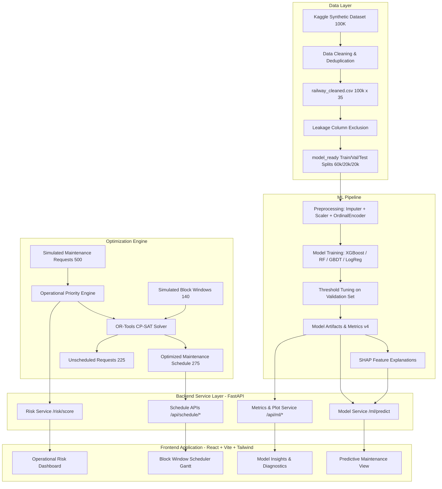
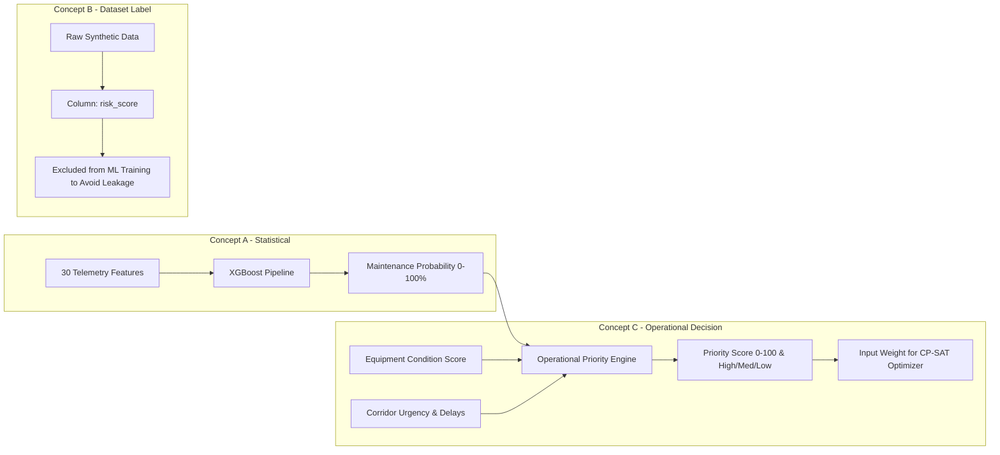
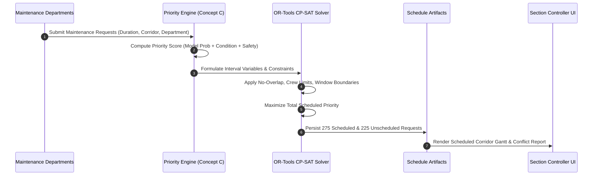

# RailSetu AI — Architecture Specification
_System Design & Component Interaction Guide_

---

## 1. High-Level System Architecture

RailSetu AI integrates predictive maintenance machine learning, constraint-based maintenance block window scheduling, and real-time operational decision support.



---

## 2. Distinction of Three Core Concepts



---

## 3. CP-SAT Maintenance Block Optimizer Workflow



---

## 4. API Service Layout & Routing

- `/api/dashboard/summary`: High-level operational KPIs, scheduled vs unscheduled counts.
- `/api/maintenance/requests`: Paginated and filterable maintenance request backlog.
- `/api/schedule/optimized`: Optimized block window assignments.
- `/api/schedule/unscheduled`: Unallocated jobs with rejection reasons (capacity, duration overflow).
- `/api/ml/predict`: Single or batch inference returning failure likelihood ($0-100\%$), decision class, and top-5 local SHAP contributors.
- `/api/risk/score`: Blended operational priority scoring combining model output with mechanical wear indicators.
- `/api/ml/metrics/*`: Transparent access to master metrics, validation/test matrices, and threshold trade-off curves.
- `/api/ml/plots/{name}`: Direct delivery of diagnostic figures (ROC, PR, Calibration, SHAP).
- `/api/ml/v5/*`: V5 active model metrics, feature selection ablation curves, repeated CV summaries, feature distribution stats, and MLflow run history.
- `/api/ml/predictions`: Query stored predictions from SQLite database with class and probability filtering.
- `/api/ml/predictions/download`: CSV export download of saved predictions.

---

## 5. Relational Database Layer (SQLAlchemy 2 + SQLite)

```mermaid
flowchart TD
    subgraph Storage Layer
        DB[(data/railsetu.db SQLite)]
    end

    subgraph Database Models
        M_REQ[maintenance_requests]
        M_WIN[block_windows]
        M_SCH[schedule_assignments]
        M_UNS[unscheduled_requests]
        M_PRED[predictions]
        M_RUN[model_runs]
        M_MET[model_metrics]
        M_THR[threshold_metrics]
        M_STAT[feature_stats]
    end

    subgraph Service Interactions
        SEED[scripts/seed_db.py] -->|Seed Simulation & Metrics| DB
        PREDICT[/api/ml/predict] -->|Persist Inferences| M_PRED
        PREDICT -->|Read Training Stats for Z-Score| M_STAT
        HISTORY[/api/ml/predictions] -->|Query History| M_PRED
        GOV[/api/ml/v5/experiments] -->|Query MLflow Runs| M_RUN
    end

    DB --- M_REQ
    DB --- M_WIN
    DB --- M_SCH
    DB --- M_UNS
    DB --- M_PRED
    DB --- M_RUN
    DB --- M_MET
    DB --- M_THR
    DB --- M_STAT
```

